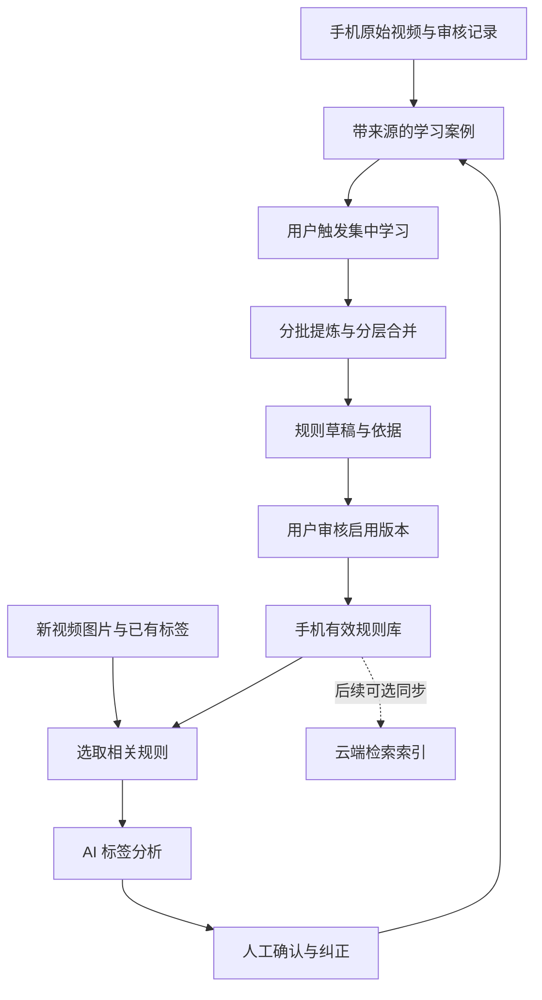

# BlitzDownloader 个人偏好学习整体方案

日期为 2026 年 11 月 27 日。实施基线为提交 `a0d6cbd`、Room v30。第一版实施入口为 [learn-local-ai-preferences](../openspec/changes/learn-local-ai-preferences/proposal.md)，本方案用于新会话接手设计与开发。

完整视频、审核记录、人工纠正和规则版本以手机数据库为准。通过用户触发的集中学习，将大量历史判断提炼成可查看、可纠正的个人规则。新视频分析优先使用这些规则；随着数据增长，再扩展增量更新和云端检索。

## 已确定的用户需求

- 希望 AI 理解个人标签标准，利用更多历史采纳、拒绝和人工修改数据。
- 完整数据继续保存在手机，允许用户主动把学习所需资料发送给已配置的 AI 服务。
- 新视频请求减少重复传输历史案例，保留当前视频的必要视觉输入。
- 已有标签包括收藏夹默认标签，AI 可以提出替换，也可以根据清晰反差证据提出双标签共存。
- 第一版沿用 OpenAI、Gemini Developer API、Vertex AI 的配置和优先级。
- 第一版交付本地规则闭环，用户操作与评估步骤见 [学习我的偏好](ai-preference-learning-v1.md)。

## 实施前的系统与问题

| 环节 | 当前实现 | 对学习效果或性能的影响 |
| --- | --- | --- |
| 原始资料 | Room 保存分析、视觉特征、逐标签反馈、偏好摘要和参考排除规则 | 可复用，手机已有基础数据 |
| 单次历史参考 | 同作者最多两条接受、两条拒绝，可能附带证据图 | 案例覆盖受限，每次重复构造与传输 |
| 偏好摘要 | 新增反馈行数达到 20 后生成，最多读取 60 行，再取五个视频 | 视频数和标签行数混用，覆盖面较窄 |
| 摘要输入 | 文案和最终标签，缺少完整拒绝、补加及视觉证据 | 难以学到具体分类边界 |
| 摘要更新 | 最近样本重新生成文本，未合并旧版知识 | 较早的有效判断可能丢失 |
| 审核来源 | 有些已有标签组自动处理，跳过也可能形成最终反馈 | 自动标签、未评价和人工否定需要区分 |
| 批量分析 | 最多三个工作协程，抽帧信号量为一 | 网络可重叠，准备耗时可能包括抽帧排队 |
| 抽帧与检测 | 先抽 12–20 个候选帧，再逐帧检测人脸 | 是十秒左右准备时间的排查对象 |

用户观察到的单请求准备时间约十秒、报文体约 100–150 KB 是问题线索，实际瓶颈需要细分计时验证。请求大小、模型输入 token、网络耗时分别统计，图片文件较小也可能消耗较多视觉 token。

## 目标架构



学习任务处理历史资料，日常标签分析读取已启用规则。规则表达标签判断标准、常见误判、混淆标签区别及共存条件，引用稳定标签 ID、源案例 ID 和证据可用性。

例如“可爱”和“甜妹”的区别，应来自用户实际纠正及画面证据。学习生成的判断标准先以草稿呈现，用户可以改写。收藏夹自动标签与模型描述保留来源标记，不能单独构成人工判断的证据。

## 分阶段实施

| 阶段 | 交付 | 验收重点 |
| --- | --- | --- |
| V1 本地规则闭环 | 手动全量学习、案例来源、规则草稿、版本启用与回滚、新请求规则注入、准备阶段细分计时 | 历史案例覆盖可核对，规则可追溯，启用后历史图片传输为零，现有分析与手工打标正常 |
| V1.1 性能优化 | 按分段计时结果优化关键帧缓存、人脸检测复用及准备队列 | 在相同视频和设备上比较准备耗时，文件改变后缓存失效 |
| V2 增量学习与精选检索 | 消化新增及修改案例，合并旧规则，检索相似正反案例，疑难项按需补图 | 不遗忘较早规则，旧判断修正后能撤销影响，精选案例优于仅按最近时间取样 |
| V3 云端知识库 | 显式同步规则和精选案例、版本化索引、按需检索、删除与失效传播 | 手机与云端版本一致，可停用云端并继续使用本地规则 |
| V4 自适应分析 | 学习误差驱动的疑难项复核和模型选择 | 人工纠正量与总成本持续可测，明确限制额外请求数量 |

第一版采用本地规则库，支持较大历史数据分批集中学习。V2 的增量合并和 V3 的云端索引可在相同案例、规则版本格式上延伸。第一版的具体约束以 [设计](../openspec/changes/learn-local-ai-preferences/design.md) 和 [规范](../openspec/changes/learn-local-ai-preferences/specs/ai-preference-learning/spec.md) 为准。

## 第一版用户流程

1. 设置页打开“学习我的偏好”，查看可用案例数、来源可信度、正负判断数量、证据图片数量、待更新数量和当前启用版本。
2. 预览全量学习计划，确认所选 AI 服务、样本数量、图片数量、确定的叶子调用数、合并调用估算范围和资料发送说明。
3. 运行学习任务。任务在前台服务中执行，通知展示案例与批次进度；失败可重试，中断可在数据仍兼容时继续。
4. 查看按标签和分类组织的规则草稿，展开查看支持、反驳和来源未知的案例。资料不足的规则明确标注待核实。
5. 编辑、禁用或启用规则，应用为一个新版本。可回滚到仍兼容当前标签与参考排除规则的版本。
6. 后续视频分析使用启用版本。日志可查看规则版本、选中的规则、文本案例数、历史图片数和分段耗时。
7. 新增人工审核只更新本地学习资料和“待更新”提示，再次主动学习后生成下一版草稿。

## 第一版数据原则

### 人工判断与自动结果

新增学习案例保留逐标签判断和来源。用户明确勾选确认、手工新增、手工删除、接受替换和接受共存可以成为监督信号。下载自动标签、自动完成的已有标签组、跳过审核和未被用户评价的标签保持未知或自动来源。

历史反馈缺少来源字段，统一按历史来源未知展示。默认学习可包含这些资料作为待核实背景，规则不能把它们计入“已人工确认”的支持数。草稿审核允许用户明确认可标准，或在原有参考管理页排除错误案例。

同一视频重复分析采用最新有效判断快照，较早分析保留追溯关系。参考排除规则贯穿学习计划、模型输入、草稿启用和后续请求，删除记录或排除资料后相应版本必须失效或重建。

### 大量资料的学习方式

学习按案例 ID 分页扫描，预览与完成报告核对覆盖数。将每条案例的文案、完整标签集合、逐标签纠正、已有结构化视觉特征及可用证据图组织为批次，分别生成局部规则，再分层合并成完整草稿。合并时保留源案例引用、反例和冲突，避免把所有历史文本重新塞进一次请求。

采用有界图片和文本预算。视觉证据不足时降低规则的可用性标记，不从只有文案的资料推断外貌审美。用户手动填写的规则优先于模型总结，后续学习应继续保留。

## 云端知识库的后续设计

OpenAI 的 Vector Stores 与 File Search 能对上传的资料建立语义和关键词索引，适合保存规则文档与结构化案例说明。云端资料使用手机案例和规则的 ID、修订号及内容哈希，按版本发布和检索。[File Search](https://developers.openai.com/api/docs/guides/tools-file-search)

原始视觉特征和历史模型描述都可能有误。精选图片和明确的人类纠正继续保留在手机；疑难项有需要时再送入多模态请求。对外部索引的检索不能假定已经看过手机里的原始视频。

同步流程采用“上传新版本、索引完成、切换活动版本、清理旧版本”。排除或删除案例时先阻止其参与当前请求，再清理云端副本，考虑索引删除的最终一致性。云端失败时使用手机有效规则，并在日志记录所用版本。[检索与索引生命周期](https://developers.openai.com/api/docs/guides/retrieval)

持久会话可以引用历史，但长会话的历史输入仍会计入输入计费。规则和检索内容需要在本次模型上下文中可用。预算应同时覆盖模型 token、检索调用和存储，不能以“上传过一次”推断后续使用没有成本。[会话状态](https://developers.openai.com/api/docs/guides/conversation-state)

## 性能测量与优化顺序

首先将当前准备耗时拆为抽帧名额等待、视频解码、人脸检测、案例读取、规则选择和请求构造，再保留上传、等待响应和响应读取计时。记录当前图片与历史图片数量、报文体字节、输入及输出 token、规则版本、服务降级尝试。

随后在相同视频集合上缓存可复用的关键帧与检测结果，以作品 ID、文件指纹、抽帧策略版本和图像参数构造缓存键。缓存属于 V1.1，失效、容量、原始文件替换和断电半写需要单独设计。

规则、标签定义和稳定的结构化输出格式放在可复用的请求前部，动态文案和当前图片随后加入。提示缓存的命中与收益通过实际 usage 验证，缓存具有有效期，手机端资料同步和长期规则库仍有独立作用。[提示缓存](https://developers.openai.com/api/docs/guides/prompt-caching)

## 质量与成本评估

保留一批用户已审核、未参与规则学习的视频作为评估集，按视频而非标签行拆分。近似重复视频也应尽量放在同一侧。评估集不能出现在规则支持案例、学习批次或文本参考中。

使用同一模型、同一当前视频图片、同一标签词表比较原流程与启用规则后的流程。记录每条视频人工删除误标数、补加漏标数、替换及共存建议接受情况、完成时间 p50/p95、历史资料传输量和每条视频成本。该结果决定是否扩大规则使用范围或接入检索，第一版不预设准确率提升百分比。

真实设备与个人样本的评估结果由实施后记录。自动测试验证数据来源、覆盖完整性、恢复、预算、规则生效和已有业务兼容性，不能代替真实偏好的质量评价。[延迟评估方法](https://developers.openai.com/api/docs/guides/latency-optimization)

## 风险与处理

| 风险 | 处理 |
| --- | --- |
| 自动标签被当成人工喜好 | 保存判断来源，自动和历史未知来源不计入人工确认数 |
| 多条相同文案混为一个案例 | 使用 awemeId 和修订号，文本只作为内容 |
| 模型自己总结的视觉描述强化旧错误 | 保留拒绝、补加、原始图证与不确定性，草稿可核查 |
| 全量学习费用较多 | 确认前展示计划调用量，限制文本与图片预算，断点复用成功批次 |
| 新旧规则冲突或用户偏好变化 | 版本化、保留反例和来源时间、人工覆写、可回滚 |
| 排除案例后旧规则继续生效 | 数据修订与来源指纹校验，受影响版本立即失效 |
| 学习占用日常分析资源 | 同一时刻执行一种 AI 批量工作，任务开始前检查并明确提示 |
| 摘要减少传输但本地准备仍慢 | 用分段日志验证，关键帧优化在独立阶段实施 |

## 第一版实施状态

Android 端已接入设置页概览、冻结计划、前台任务、检查点、草稿审核、版本启用及回滚。Room 数据库从 v30 显式迁移到 v31。单条和批量分析共享规则选择与准备计时。用户操作、预算与评估记录表见 [学习我的偏好](ai-preference-learning-v1.md)。

真实样本侧的效果和成本尚待评估。前台服务切后台、进程退出和恢复的完整设备场景及系统 SAF 文件选择器交互也待验收。验证状态见 [任务清单](../openspec/changes/learn-local-ai-preferences/tasks.md)。

### 第一版验收范围

2026 年 11 月 27 日，OpenSpec 严格校验通过，JVM 255 项通过，标准 Debug APK 已通过签名检查。Mi 10（API 33）的独立测试应用通过 20 项设备用例。

| 场景 | 验证方法 |
| --- | --- |
| 计划确认、来源计数、历史去重与覆盖 | 独立测试应用中的 Compose 预览和 Room 用例。使用同文案、不同作品 ID 的 105 个案例，模拟失败后继续 |
| 版本审核、参考排除、规则预算和当前作品隔离 | Room 端到端夹具与 JVM 选择器用例，涵盖草稿确认、来源变化后的失效、完整规则装包与文本案例去重 |
| 协议请求和分析日志 | 使用拦截器模拟三家服务响应，验证结构化输出和图证分辨率。使用可控时钟核对准备分段，保留网络尝试与字节统计 |
| Room 升级和备份恢复 | 在独立测试应用导入合成旧库，分别覆盖直接升级、文件备份恢复和 SAF 输入流恢复核心路径 |
| 前台生命周期、真实个人样本和模型调用 | 待实测。需验收切后台、进程退出和恢复，收集准确性、耗时分位数、token 与历史传输量 |

## 新会话交接

按以下顺序阅读。

1. 仓库 `AGENTS.md` 和 `CLAUDE.md`。
2. 本整体方案。
3. `openspec/changes/learn-local-ai-preferences/proposal.md`。
4. 同目录 `design.md`、两份 `specs/*/spec.md` 和 `tasks.md`。
5. `.cursor/rules/db-schema.md` 及设计列出的实际代码入口。

可在新会话粘贴以下指令。

```text
请从当前仓库的实现和任务清单继续验收 OpenSpec 变更 learn-local-ai-preferences。
先读 AGENTS.md、CLAUDE.md、docs/ai-preference-learning-plan.md，以及该变更的 proposal、design、specs 和 tasks。
使用 openspec-apply-change 按任务实施并验证第一版。
第一版范围为手动全量学习、本地规则库及审核版本、日常分析规则注入、准备阶段细分计时。
云端检索、增量学习和关键帧缓存按整体路线留给后续变更。
实施前检查 Git 状态和当前 Room 版本，保留无关工作区改动。协议测试使用模拟响应；需要真实 AI 验证时，遵循用户授权和已有凭据流程。
完成后提供验证结果和 Debug APK；真实 AI 质量及设备性能数据只报告实际完成的验证。
```

若新会话在同一工作区，可以直接读取这些文件；换工作树或换机器前先检查规划文件的 Git 状态，确保新环境也包含完整交接资料。
