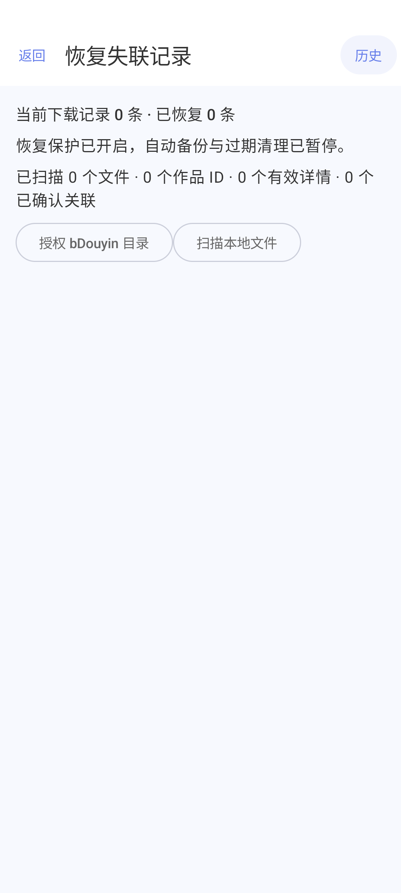

# 恢复失联记录

从「设置 → 恢复失联记录」进入。打开页面只读任务概况。授权目录时选择内部存储的 `Download/bDouyin`。Android 29 使用系统目录授权，Android 30 以上可以复用已有的所有文件访问权限。自动数据库维护在本版本默认暂停，手动备份仍可用。

1. 点击「扫描本地文件」。扫描视频、图片、封面和封面下的 evidence 目录。文件数和作品 ID 数独立计算。同一个作品的三张证据图会占三个文件、一个作品 ID。读取失败时保留上一次完整清单。
2. 点击「查询 / 继续」。恢复模块使用当前登录态向现有作品详情地址发送普通 HTTPS 请求，只传作品 ID 和必要的请求参数。401/403 暂停并显示登录或访问受限，429 等待后手动继续。不会自动遍历作者作品或收藏夹。作品 ID 指向作品，sec_user_id 指向作者，昵称可能重名。F2 的 query_user 不能用作任意昵称搜索。真实查询须有可用登录态、用户主动触发、接口允许当前账号访问。 [F2 接口说明](https://f2.wiki/guide/apps/douyin/overview)
3. 在「可确认」或「需复核」打开作品，对照主文件、图集成员、本地证据与远端描述。多个副本逐项选择主文件。相同昵称和描述只用于缩小抽帧范围。只有证据而没有对应媒体的作品留在「未匹配」。可为待识别文件补充作品链接。审核预览不增加观看、标签或反馈计数。
4. 确认关联后，手动勾选要写回的作品。「预览写回」列出文件、封面、预计新增数、备份位置与空间。只有点击「备份并新增」才开始。每批最多 50 项，每个实际新增批次单独备份。离开页面可从通知返回，进程中断后请查看历史并重新预览。
5. 在「历史」查看每批实际新增、跳过和未处理项，或导出 JSON。管理页显示“恢复于”。原下载时间、观看、导出与编辑历史未知。恢复后发生的真实操作正常记录。



## 中断后从哪里继续

按 Home 切到后台后，前台服务可以继续工作。若进程被结束，再次打开「设置 → 恢复失联记录」可查看持久化的进度，由用户决定下一步。

| 中断阶段 | 再次打开后的操作 |
| --- | --- |
| 扫描 | 重新点击「扫描本地文件」从头扫描。有上一次完整扫描时，也可直接查看那次清单。 |
| 查询与匹配 | 点击「查询 / 继续」。登录态相同时会复用 24 小时内已保存的成功详情。如果详情齐全，点「匹配已有详情」可继续本地匹配。 |
| 人工审核 | 已保存的确认会保留。重新勾选本次要写回的记录，文件、授权或详情已变化时按提示复核。 |
| 备份与写回 | 打开「历史」查看各批实际新增和待处理数。未提交的事务会整体回滚，已提交批次保留。对剩余项重新预览并生成新备份，即可再次提交。 |

## 数据库和写回

Room v32 通过 v31 导出 schema 生成仅新增表和索引的 AutoMigration。session 记录代次，file 以会话和逻辑路径去重，work 以会话和作品 ID 去重，candidate 保存对应关系和审核 revision，batch 和 batch_item 保存冻结清单和事务结果，record 将实际新增行与来源关联。下载记录创建冲突返回 -1，显式编辑仍使用原更新路径。

手动备份、整库恢复与恢复写回共享互斥锁。每批将一致 SQLite 快照发布至 `Download/bDouyin/recovery-backups/<操作 ID>/<批次 ID>/`。外部 DB 回读 SHA-256 与大小校验成功后，最后发布 `recovery-manifest.json`。清单记录 schema 版本、时间、字节数、摘要和批次身份。该目录独立保留。权限、空间或摘要异常会阻止写入。单个批次在一个 Room 事务内插入下载行、来源与账本。已提交批次可由账本重建结果，后续批次失败时保留先前成果。重试需要重新预览、重新备份。

## 管理页与恢复来源

系统在恢复记录上保存主文件、参与确认的有序成员和完整摘要。管理列表显示恢复日期及恢复后实际操作次数。图集预览按勾选顺序读取，ZIP 和局域网导出使用同一份成员清单。授权被撤销时可以回到恢复页面重新授权。清除失效只处理能从可读父目录证明已缺失的路径。

## 合成验收样例

```text
Download/bDouyin/
  videos/合成作者_样本_7390000000000000001.mp4
  videos/合成作者_样本_7390000000000000001 (1).mp4
  images/合成图集_7390000000000000002_01.jpg
  images/合成图集_7390000000000000002_03.jpg
  covers/合成作者_样本_7390000000000000001.jpg
  covers/evidence/7390000000000000001_evidence_0.jpg
```

同一作品两个视频需确认主文件，图集缺页需复核。首尾各 64 KiB 的快速摘要用于扫描，确认和写回重新流式计算全文 SHA-256。恢复保护在应用启动和自动维护任务获取锁后分别检查。数据库缺少迁移时保留原库并报告打开失败。

构建产物、已验证场景、设备覆盖范围及新会话的复测方法见[验收与交接记录](media-recovery-validation.md)。
