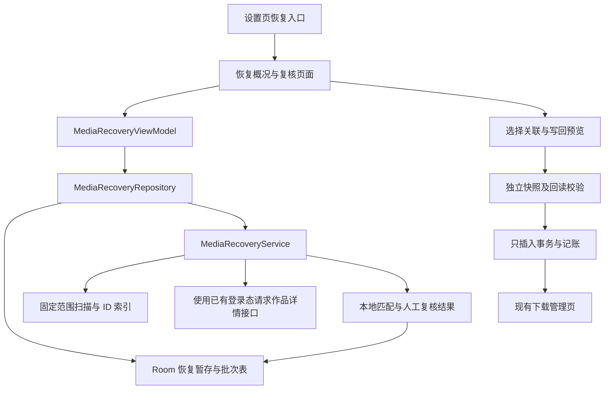

# Design

## Context

动机与范围见 [proposal.md](proposal.md)，行为契约见 [spec.md](specs/lost-media-recovery/spec.md)，盘点方法与恢复步骤见 [总体恢复方案](../../../docs/lost-video-data-recovery-plan.md)。

设计基线为 Room v31，交付版本为 v32。文件名与证据帧按作品 ID 去重后形成待核验清单，实际恢复数取自已提交的批次。交付版本默认开启恢复保护。

实施前影响设计的条件如下。

- `DownloadedVideoDao.insert` 使用 REPLACE，恢复流程不得复用它或 `recordSuccessfulDownload`。
- `DouyinParser.fetchVideoDetail` 只返回对象/null，吞掉 HTTP 分类及部分取消异常，不足以支撑可靠重试。
- `DownloadedMediaFileManager.resolveFile` 返回 File，现有孤儿扫描仅扫目录本层，不含 `covers/evidence`；不能直接拿来完成恢复扫描或 SAF 播放。
- `downloadType` 尚无“恢复”来源，观看/导出/编辑字段也不支持“历史未知”；仅填零会产生错误展示与筛选。
- 手动备份、学习和 AI 并发控制已有部分工作区实现，但自动备份变更尚未验收；只复用通过本变更验证的快照原语，不依赖自动任务上线。

## Goals / Non-Goals

**Goals:** 在 Android API 24–36 上提供从本地扫描、ID 详情查询、候选确认到安全新增的完整可续跑流程；旧业务数据零意外覆盖；权限错误不等于文件不存在；能够独立测试所有写入前置条件。

**Non-Goals:** 第一版不自动遍历作者主页、喜欢/收藏及昵称搜索，不进行云端向量检索或 AI 自动补标签，不重下载视频，不自动修复既有记录路径，不自动删除孤儿文件，不提供一键整库回滚。用户可以为无 ID 文件手动补充作品链接；作者分页召回属于下一变更。

## Decisions

### 1. 总体架构和模块边界



| 位置 | 责任 |
| --- | --- |
| `activity/MediaRecoveryActivity.kt` | 单 Activity + Compose 页内路由：概况、结果、候选详情、预览、历史 |
| `viewmodel/MediaRecoveryViewModel.kt` | 观察 Room、调度查询与写回命令；不持有 Activity、View 或 UI 文案 |
| `data/MediaRecoveryRepository.kt` | 会话、审核、预览和只新增写回；由 BlitzApp 唯一持有 |
| `data/MediaRecoveryScanner.kt` | 文件范围、分组、ID 来源与既有引用索引 |
| `data/MediaRecoveryMatcher.kt` | 本地候选生成、匹配依据和确认指纹 |
| `data/RecoveryMediaAccess.kt` | File/SAF 统一枚举、读取、元数据与授权状态 |
| `api/RecoveryDetailFetcher.kt` | 向已有详情地址发送普通 HTTPS 请求并校验作品身份、响应大小与字段 |
| `data/db/MediaRecoveryEntities.kt`、`MediaRecoveryDao.kt` | 下述暂存、批次及来源表 |
| `service/MediaRecoveryService.kt` | 用户触发的扫描、查询、匹配、备份/写回作业与进度通知 |
| `data/RecoveryBackupStore.kt` | 恢复前快照发布、验证和备份身份，不参与普通保留期清理 |
| `model/MediaRecoveryModels.kt` | 状态、计数、版本化 JSON DTO 与纯规则 |

不把 HTTP、全目录扫描或匹配放在 Composable/Activity 中。不增加新的底部 tab。

### 2. UI 页面与明确操作

全部新增页面和弹窗使用 Compose + Material 3、BlitzTheme、系统栏避让；标签等旧页面保持不变。页面选择、滚动及展开状态使用 `rememberSaveable`，业务任务和审核结果持久化在 Room。

| 页面 | 内容及操作 | 启用条件 |
| --- | --- | --- |
| 恢复概况 | 当前记录数、文件数、ID 数、上次任务；“授权下载目录”“扫描本地文件”“查询作品信息” | 扫描需要读权限；查询需要完整扫描与有效登录 |
| 查询/匹配进度 | 当前阶段、成功/失败/未处理计数；“暂停”“继续”“停止本次处理” | 控件防重复，不因返回页面取消任务 |
| 恢复结果 | 可确认、需复核、未匹配、远端不可访问四类；搜索文件名/ID、仅显示未写回项 | 可确认仍需用户确认对应关系 |
| 候选详情 | 本地视频/图集预览、作品 ID/作者/描述、本地证据帧、匹配依据；“确认关联”“选择其他文件”“排除此关联”“填写作品链接” | 预览读取授权资源；不调用会写 watched 的管理页播放入口 |
| 写回预览 | 所选作品及主路径、预计新增/已存在/冲突、未知历史说明、每 50 项一批及备份位置；“备份并恢复所选记录” | 仅 CONFIRMED 项，所有项有当前指纹；默认不勾选 |
| 恢复历史 | 每批计数、逐项原因、备份位置、报告导出；打开现有恢复入口前解释整库恢复会影响后来修改 | 无后台自动回滚按钮 |

“全选可确认项”仅选择 READY 候选，之后还须明确“确认所选关联”，不能批量确认多候选冲突项。确认关联与最终写回是两个动作。权限返回、登录返回、详情完成不代替最终写回确认。

写回处理中只在事务边界接受暂停；正在提交的子批次完成或回滚后停止。离开页面继续工作，结束 Toast 只提示实际结果。通知提供返回页面与暂停，通知拒绝不阻断页面内执行，不能假定息屏下永不被系统停止。

### 3. 存储访问：同一逻辑路径，两种读取后端

统一逻辑键为 `Download/bDouyin/<限定子目录>/<文件名>`。File 后端与 SAF 后端生成相同逻辑键，避免一次媒体产生两项。扫描只支持主共享存储固定 `bDouyin`，不接受云盘或任意卷作为媒体源。

- API 24–28：沿用读写运行时权限，也允许使用 SAF；拒绝不扫描。
- API 29：使用 `ACTION_OPEN_DOCUMENT_TREE` 授权 `Download/bDouyin` 子目录，持久保存实际 read/write grant。
- API 30+：已拥有且实际可读取的所有文件访问权限时可以用 File；否则使用同一 SAF 子目录授权。不能把仅部分照片授权当成完整证据目录访问。
- 校验 SAF 的 authority 为系统 ExternalStorageProvider，解码 documentId 为 `primary:Download/bDouyin`，不要求用户选择 Android 11 已限制的 Download 根目录。无写授权可扫描和复核，但写回前独立备份需另获可写目录授权。
- 只枚举 `videos`、`images`、`covers` 的直接文件及 `covers/evidence` 的直接文件，不递归其他目录；跳过 `.nomedia`、临时文件、备份目录、未知类型和链接。File 使用 `lstat` 与根目录边界双重验证；SAF 验证每个 document 的父级与类型，不从路径字符串拼装跨目录 URI。
- 扫描状态包含 COMPLETE/INCOMPLETE/NEEDS_PERMISSION，只有完整扫描代次可形成写回预览；拒绝访问与真实 NOT_FOUND 分开。

`RecoveryMediaAccess` 返回 `MediaRef(logicalPath, backend, locator, size, modifiedAt, accessState)`，提供 `openRead`、`openFileDescriptor`、`listImageSiblings`，不提供删除或移动 API。新增 `DownloadedMediaReadResolver` 统一 File 优先、授权失效识别及 SAF 回退；管理预览、VideoPlayerActivity、ImageViewerActivity、媒体尺寸探测、局域网和 ZIP 导出接入它，不能把 content URI 塞给只接受 File 的旧函数。`DownloadedVideoEntity.filePath/coverPath` 仍存逻辑路径，持久 URI 映射存于恢复文件/来源信息中。

已恢复条目读取失败显示“需要目录授权”。`clearInvalid` 必须在真实确认 NOT_FOUND 时才允许列为失效；DENIED/UNKNOWN 不删除。恢复页本地预览不使用现有“进入管理播放器即标记已看过”的副作用。

依据：[Android SAF 文档](https://developer.android.com/training/data-storage/shared/documents-files)、[Android 11 目录授权限制](https://developer.android.com/about/versions/11/privacy/storage)。

### 4. Room 数据模型和迁移

选择在主 AppDatabase 增加暂存与账本表，使下载插入、来源和批次结果能同事务提交，避免使用两套数据库后无法原子记账。扫描/查询会改变恢复暂存表，不改变下载、标签或反馈业务表。

基线为 v31。Room 依据已导出的 v31 和 v32 schema 生成 `@AutoMigration(from = 31, to = 32)`，仅增加恢复表及其索引。升级测试从合成 v18 和 v31 数据库核对原有行。JSON DTO 带 `schemaVersion`，数据库只保存必要的归一化详情。

| 新表 | 主键、唯一约束及核心字段 |
| --- | --- |
| `media_recovery_session` | `sessionId` PK；状态、阶段、scanGeneration、policyVersion、authScopeHash、创建/更新时间、逐类计数及错误码 |
| `media_recovery_file` | `fileId` PK，UNIQUE(sessionId, logicalPath)；backend/locator、类型、groupKey、size/mtime、quickHash、fullSha256 可空、时长/尺寸、识别 ID/证据序号、accessState、generation |
| `media_recovery_work` | PK(sessionId, awemeId)；来源 fileIds JSON、查询状态、normalizedDetailJson、detailHash、fetchedAt、authScopeHash、尝试次数、错误码/HTTP 状态及计时 |
| `media_recovery_candidate` | `candidateId` PK，UNIQUE(sessionId, awemeId, groupKey)；文件集合、主文件/封面、匹配方法及分数、歧义原因、审核状态、revision、确认指纹/时间、审核方式 |
| `media_recovery_batch` | `batchId` PK；operationId/sessionId、子批次序号、不可变清单 JSON/摘要、备份 locator/size/hash/验证时间、状态、起止时间及分类计数 |
| `media_recovery_batch_item` | PK(batchId, awemeId)；candidateId、确认指纹、待插入归一化字段及 payloadHash、状态、实际 rowId 和错误码；索引(batchId,status) |
| `media_recovery_record` | `awemeId` PK；`videoRowId` UNIQUE 外键指向 downloaded_videos.id 且 ON DELETE CASCADE；batchId、导入时间、主文件与图集文件 locator 快照、未知历史字段集合及数据来源 |

session/work/candidate/file 索引覆盖会话、状态及作品 ID；子表 FK 引用相应父表，会话历史不自动删除。`media_recovery_record.batchId` 作为审计来源稳定保留，不能因清空任务列表破坏已恢复记录的未知历史语义。本版不提供批量清空恢复历史功能。

`DownloadSourceType` 增加 `RECOVERED = "recovered"`，来源统计与筛选显示“恢复”。新记录其他缺失来源字段为空，不能假装 post/like/collects。不新增原下载来源的重复列；未来有真实佐证时再单独设计来源校正。

`createdAtMillis` 取本批导入时间，UI 显示“恢复入库时间”，provenance 标记原下载时间未知；它不是文件 mtime。`watched=false`、`exportCount=0`、`tagEditCount=0` 是兼容旧表的物理值，未知字段集合使 UI 与筛选不把它们解释为原历史为零。

### 5. 扫描、ID 解析与快照身份

完整扫描完成时发布不可变代次。中断扫描暂存行保留但不能覆盖上次完整代次，继续或重新扫描后再计算差异；每 100 文件保存扫描进度，不在内存收集全部 Bitmap。

- 视频 ID 只接受基础名末尾独立的 15–22 位数字，兼容文件系统追加的 `(n)` 后缀；图片先分离 `_01` 等有界序号再识别 ID。64 位十六进制文件名后缀不是原作品 ID，不反推。
- 证据帧严格识别 `^(\d{15,22})_evidence_(\d+)\.jpg$`，保存 ID→帧和 frameIndex；0 是封面，其他序号不是时间戳。
- 同一 ID 合并来源关系，已存在下载记录标记 ALREADY_PRESENT，但其证据文件不能因此被删除。
- 图集按目录、基础名和连续序号先分组，保留空洞、重复序号、同基础名多 ID 等冲突，不把普通视频放进图集。
- 文件指纹先取逻辑路径、类型、size/mtime 与文件首尾各 64 KiB 的 quickHash；被用户确认或即将写入的所有主媒体/图集成员，以及被用于本次确认的封面和证据帧均计算完整 SHA-256。quickHash 仅用于缓存，不足以最终授权写回。
- 不直接导入电脑 `recovery-local` 中的个人清单作为当前真机事实；本版会重新扫描。该目录只作为受保护证据和对照样本，不提交 Git 或打包 APK。

### 6. 详情查询协议、缓存与重试

恢复模块调用 `RecoveryDetailFetcher.fetch(id, cookie)`，返回 SUCCESS、AUTH_REQUIRED、RATE_LIMITED、NETWORK_ERROR、REMOTE_UNAVAILABLE、INVALID_RESPONSE 或 ID_MISMATCH。请求沿用同一作品详情地址和登录态。空响应记录为无效响应。

下载模块保留原有接口。两个模块都向上传播协程取消。HTTP 401/403 进入授权或访问限制状态。429 暂停队列并记录 Retry-After。远端明确不可访问时使用 REMOTE_UNAVAILABLE。成功 DTO 校验 ID、媒体类型、作者字段和时间单位。没有合法本地对应时只记录远端作品。

并发上限 2，全局发起间隔至少 1 秒（含重试）。连接超时 15 秒、单次请求总超时 45 秒；网络异常/408/5xx 最多额外 2 次退避重试（2、5 秒，可注入时钟）；429 不自动循环，无有效 Retry-After 时至少 60 秒后才允许用户继续。单项错误不清空已完成结果。

归一化详情缓存 24 小时；重新确认已过期详情前先刷新。authScopeHash 来自明确登录/退出 epoch 与稳定会话字段的摘要，不包含动态 msToken，原 Cookie 仅按现有安全配置在运行时读取。登录账号/稳定登录态变化时暂停队列，旧结果保留展示但必须按新登录态重新验证，依赖该详情的确认失效。不持久化签名链接或输出凭据。

手动输入作品 ID 或抖音作品长链接可本地解析；短链接仅走现有受限抖音链接展开链路，不访问用户任意输入的外部 URL。第一版不调用昵称搜索；F2 `fetch_query_user()` 不能被当作任意昵称检索。[F2 接口文档](https://f2.wiki/guide/apps/douyin/overview)

**实施说明**　接口地址和已登录账号沿用现有项目。已有 HTTP 拦截器会为受限请求附加绕过网关检查的标记，并打印完整 URL。恢复模块使用独立 OkHttp 客户端直接请求同一作品详情地址，关闭自动跳转和隐式 HTTP 重试。401/403 停队。Mock 响应验证字段和状态，真实账号的接口可用性需单独实测。短链展开使用不携带 Cookie 的域名白名单。上述方式取代本节最初对整个签名客户端的复用设想。

### 7. 有界本地匹配与确认指纹

V1 匹配不调用 AI，不上传视觉文件。需要预览的图片只读取本地证据和本地封面；不为匹配批量下载视频或远端封面。

1. 为本地普通封面建立 dHash-64 索引；灰度缩放到 9×8 后比较相邻像素。所有图像计算先旋转归一化，保持内容方向；按文件指纹缓存。只保留小图及哈希，Bitmap 使用后释放。
2. **文件名 ID 路径**：同 ID 召回；核对本地/远端媒体类型和可用时长，时长容差 `max(750ms, 远端时长×2%)`。多副本、类型不符、时长明显不符进入 REVIEW；不能仅因名字含 ID 就绕过用户确认。
3. **证据帧路径**：有 frameIndex=0 时先对普通封面检索，要求候选封面能通过同基础名唯一对应到本地媒体。默认 dHash 距离≤8、相邻第二候选距离差≥6，并核对时长才标记 READY；READY 文案是“建议关联，待确认”。
4. **中段帧路径**：先用作者/描述按历史文件名规则召回，不以它们定论，每作品最多自动比较 5 个视频。每视频均匀解码最多 12 帧，解码并发为 1，缓存上限 100 MiB。至少两张不同内容证据帧各自命中不同采样帧且距离≤8，合计相对第二候选优势≥12，再满足类型/时长才能 READY；不足两帧或同画面歧义进入 REVIEW。
5. 图集比较本地有序缩略图和该 ID 的证据图，类型、组序号和匹配存在歧义时不自动 READY。远端没有本地可验证画面时用户逐组确认；不能以文件数量一致代替身份验证。
6. 无合理召回时标记 LOCAL_UNMATCHED 或 REMOTE_ONLY，允许用户从扫描清单选择文件复核，不进行无界的“所有证据帧×所有视频”抽帧。

阈值是可版本化的首版规则，不是成功率承诺。用已知 ID 的正反样本（含同作者同描述不同视频）校准；验收要求负样本不能自动进入 CONFIRMED。**任何评分都不能自动进入 CONFIRMED**，只有用户明确单项或对 READY 集合确认才能写入审核状态。

确认指纹为 `SHA256(policyVersion + detailHash + workId + orderedFileFullHashes + main/coverLocators + candidateRevision)`。预览冻结该指纹；详情刷新、文件变化、分组变化或选择变化立即让审核失效。写回前复核全文哈希与可读性，不能只看 mtime。

### 8. 任务状态、持久化和后台生命周期

会话：NEW → SCANNING → SCANNED → FETCHING → MATCHING → REVIEW_READY；可进入 PAUSED、INTERRUPTED、NEEDS_PERMISSION、AUTH_REQUIRED 或 FAILED。扫描/查询/匹配分别保存阶段，用户重新开始哪一阶段必须显式选择。单作品请求状态与候选审核状态独立，不把 HTTP 成功等同于恢复成功。

候选：UNMATCHED、REMOTE_ONLY、REVIEW、READY、CONFIRMED、EXCLUDED、STALE、APPLIED、ALREADY_PRESENT。确认/排除按 revision 做条件更新，避免旧弹窗覆盖新结果。

`MediaRecoveryService` 使用现有 `dataSync` 前台服务模式，只在前台用户动作后启动，不 START_STICKY 自动继续。单一活动恢复任务；忙时返回既有任务入口。抽帧/备份/写入阶段通过 owner=`recovery:<sessionId>` 接入现有 AiWorkGate，与批量 AI/偏好学习互斥；网络详情阶段允许其他 UI 读取，但不同时启动第二恢复作业。失去 gate 只等待用户选择继续，不擅自取消他人任务。

每个请求完成或候选处理完成即事务落库；取消先停止出队，再取消请求并等待子协程结束、释放解码器与 gate。后台/息屏只是任务仍可能存活，不承诺突破系统限制；超时、强停、服务销毁将工作状态标 INTERRUPTED，已完成结果保留，下次打开由恢复例程只校正状态，不自动联网或写库。

### 9. 恢复前独立备份与自动任务保护

正式构建新增持久恢复保护开关，**默认 true**。在 `BlitzApp` 注册自动备份回调前检查，同时在协调器执行入口再次检查；开启时不自动备份/清理，不扫描后删除孤儿媒体。V1 页面只展示保护已开启，不提供自动关闭开关；结束恢复后如需恢复自动保留策略另行明确决定。现有用户手动选择删除仍走既有确认，不由恢复任务发起。

恢复前备份固定放在独立 `Download/bDouyin/recovery-backups/<operationId>/<batchId>/`，不放入普通 `backup` 目录，也不由普通 30 天清理扫描。File 或已获写授权的 bDouyin SAF tree 均可发布；不将 app cache 作为唯一备份。

复用并独立验证 `DatabaseSnapshot.create` 的事务内逻辑快照：包括当前 schema、全部表数据、Room identity、索引/视图/触发器及序列，校验 quick_check、外键和行数。不能复制仍在写入的 DB/WAL 文件组，也不关闭共享 Room 连接。

先输出内部临时文件，校验后流式发布独立目录，回读外部文件核对大小/SHA-256，最后写 `recovery-manifest.json` 完成标记。File 可同卷重命名；SAF 不假定 rename 原子性，以唯一目录和最后完成标记判定有效。manifest 包含 operationId/batchId、schemaVersion、创建/验证时间、大小/摘要、`protected=true` 和冻结清单 hash。只有发布和回读校验成功后才能进行下一步。

在 `BackupMaintenance` 增加可挂起的互斥操作块，与手动备份/整库恢复共用一个锁；新增恢复写回持该锁完成“检查→备份→复核→提交”，不能备份之后先释放锁让整库恢复插队。下载/标签普通写事务仍由 Room 串行化；写回只新增，因此不覆盖并行的旧记录编辑。持锁不暂停用户正常浏览。

### 10. 批次预览、插入和幂等性

一次确认生成不可变 operation 清单，包含候选 revision/指纹、目标主路径、完整输入字段与 schema/policyVersion。按作品 ID 稳定排序，每 **50 个作品**为一个独立子批次；每个子批次各自做新备份。用户在预览看到总批数与备份空间需求；空间不足就停，不能减少备份或改为无备份写入。

子批次状态：PLANNED → BACKING_UP → BACKUP_VERIFIED → COMMITTING → COMMITTED / FAILED / STALE；操作可以是 PARTIAL 或 PAUSED。所有行已存在时直接标记跳过且不需要空批备份，但不能改变任何旧行。

```text
取得恢复操作锁；重新读取冻结清单与候选
检查权限、媒体全文指纹、当前下载 ID 集合
若还有合法新增项：生成并回读独立备份
再次确认备份可读及候选未变化
Room.withTransaction:
  复核候选 revision 与清单 hash
  对每个候选使用 @Insert(onConflict = IGNORE)，返回新 rowId 或 -1
  -1：记 SKIPPED_EXISTING；不更新旧行
  新 rowId：保存 media_recovery_record 和 SUCCEEDED 账本
  同事务保存 batch COMMITTED、准确计数
事务结束后发送结果，释放操作锁
```

不得用旧 REPLACE DAO、UPSERT update 分支、整行 update 或恢复整库的函数实现新增。事务内不做 HTTP、备份或文件哈希。文件若在提交之后又被外部替换，管理页仍按文件指纹及访问状态提示；数据库事务无法锁住外部文件系统，不宣称可防止任意外部并发篡改。

取消在子批次事务前生效，已提交的不撤销。崩溃发生在提交前则整个事务回滚；提交后 UI 尚未更新则以事务账本恢复。备份已发布但没记入 batch 时，重启按 batchId 和 manifest hash 查找、回读校验；必须用户重新预览确认，并为新的提交尝试创建新快照，旧备份留存。不能因为某个文件名含 batchId 就跳过校验。

同一 ID 被普通下载在备份后插入也使用 IGNORE 跳过；不得覆盖其标签或历史。为防止普通下载较晚完成后用旧 REPLACE 反向覆盖恢复结果，普通下载的“创建成功记录”路径也改为 insert-ignore-if-absent，已有行及 provenance 保留；显式用户编辑仍走原 update 方法，不把所有更新改成插入。两个竞态顺序都必须验证。

事务异常回滚整批记账与新增，事务外写 FAILED 结果。先前已提交批次不回滚。前置核验失败项记 STALE，剔除后清单变化必须重新预览确认，不静默缩减用户确认范围。报告分类互斥：成功、已存在跳过、过期、失败、未处理之和等于冻结清单作品数；备份失败的子批次项属于未处理，批次另显示备份失败原因。

### 11. 来源、字段映射与未知历史

| 下载字段 | 恢复写入来源 |
| --- | --- |
| awemeId | 已验证的远端 ID 与用户确认关联 |
| mediaType、userName、desc、videoAuthorSecUserId、createTime | 校验后的详情；类型必须与本地一致，时间按接口秒级 |
| filePath、coverPath、hasLivePhoto、mediaWidth/Height | 真实本地文件及图集结构，尺寸按本地呈现方向；无合法封面允许空并展示占位 |
| downloadType | recovered |
| sourceOwnerSecUserId、collectionType、collectId、userRelation | 空；V1 不声称知道原来源 |
| createdAtMillis | 本次恢复入库时间；provenance 标记原下载时间未知 |
| watched、exportCount、tagEditCount | 兼容值 false/0/0，provenance 明确对应历史未知 |
| diggCount、collectCount | 本次详情的统计快照；不是原下载时统计 |

不写 video_tags、历史 video_tag_feedback、tag_preference、ai_preference_case 或学习版本。恢复完成不触发 AI 自动分析；用户之后主动编辑/分析走正常流程，只记录新事件。标签未知不等于“不喜欢”，空标签不得投影成负反馈；检查现有 AiPreferenceCases 的人工来源过滤。

管理页为 recovered 显示“恢复记录”，下载时间显示“恢复于”。未知 watched 不进入确定“未看过”筛选；之后真实播放可变为已看过。导出/编辑计数在 provenance 存在时表示“恢复后 N 次，原历史未知”，不进入确定“从未导出/从未编辑”筛选；N>0 可以进入“有导出/有编辑”筛选。统计中的未知桶单列，不让它们悄悄消失。

### 12. 可验证性、导出与资源边界

- 报告 JSON schema v1，含扫描代次/计数、候选 ID、逻辑路径、证据方法、审核状态、实际 batch 结果与备份位置；通过 SAF CreateDocument 导出。报告不含 Cookie/AI Key/签名 URL，不默认导出图片。
- 分页读取候选，UI 每页 50；归一化详情每项最多 64 KiB，响应体解析前上限 2 MiB。超限记 INVALID_RESPONSE，不截断成“成功”。
- 抽帧并发 1、网络并发 2、单文件全文 hash 流式 64 KiB buffer；不在主线程查询全库、枚举目录或读文件。进度分阶段，不编造总 ETA。
- 备份空间预检以当前 SQLite 文件规模、内部临时副本和每个 50 项子批次外部副本为基础预估；真实写入失败仍必须保留原媒体并停止后续子批次。不启动缓存清除、媒体删除或备份清理腾空间。
- 写回后对照新增 rowId/awemeId、账本、provenance 和当前实际数；UI 的“已恢复”只来自提交账本。

## Risks / Trade-offs

- 有证据 ID 但尚未确认对应媒体的作品保留为 REMOTE_ONLY，单独统计。
- [同人同文案同场景易误匹配] → 多证据召回、负样本校准、任何分数都不自动 CONFIRMED，歧义必须人工核验。
- [SAF 与旧 File 消费链不兼容] → 将读取解析器接入预览、播放、图集、探测和导出，授权失效与真缺失分开；不能只做恢复页而交付不可播放记录。
- [多批独立备份占空间] → 50 项子批次、预估并逐批校验；宁可暂停，不以删除旧副本或合并未知备份降低保护。
- [工作区已有未完成自动备份和偏好功能] → 显式恢复保护默认开启，独立验证快照，不以任务文件打勾作为兼容证据，不覆盖无关改动。
- [新数据进入后整库回滚会吞掉用户操作] → V1 不提供自动回滚，只显示备份及解释现有手动整库恢复的影响。

## Migration Plan

1. 先固化保护默认值、七表增量迁移、IGNORE 插入与未知历史语义，再接入 UI 与任务。不得在迁移验证前启动真实库。
2. 用合成 v18/v31 数据验证升级至实际新版本，保留下载/标签/关联/分析/学习表；新版本必须去掉 destructive fallback。旧 v31 备份导入后依然能走显式迁移，SAF 恢复入口不退化。
3. JVM 用模拟响应；设备验证仅固定序列号的模拟器或独立 `.recoveryvalidation` 包，安装前校验包名/证书，显式 `adb -s`、覆盖安装，不运行对生产包有自动卸载行为的 connected 测试，不用 pm clear 或卸载做测试准备。
4. 本变更的实施授权不等于安装到真机或写回真实数据的授权。先交付已校验 APK/模拟器结果，用户明确选择生产安装及实际恢复批次后才操作；既有用户的明确授权按实际范围沿用。
5. 默认恢复保护保留到用户明确结束恢复；不在升级、任务结束或空闲超时后自动解除。发布前检查普通工作区构建已具备此保护，不能只修改忽略目录里的专用副本。
6. 代码回退不通过旧 APK 强行降级当前数据库。停止恢复任务、保留备份与账本，使用兼容 schema 的修复版本；任何整库恢复由用户独立确认。

## 新会话实施入口

```text
请从 recover-unlinked-media 的任务清单和 docs/media-recovery-validation.md 继续验收现有实现。
先读 AGENTS.md、CLAUDE.md、.cursor/rules/db-schema.md、
docs/lost-video-data-recovery-plan.md，以及本变更全部 proposal/design/specs/tasks。
第一版只实现 ID 与证据帧恢复、手动补充作品链接、复核及独立备份后只新增；
作者分页/昵称搜索留给下一变更。先验证保护和迁移，再接入业务。
保留当前工作区其他改动，不提交个人恢复数据。
只在明确指定的模拟器或独立验证包测试，禁止生产包自动卸载、清数据和整库覆盖写回。
完成后提供 Debug APK、验证证据及未完成项；真实手机安装/批次写回按用户明确授权执行。
```
